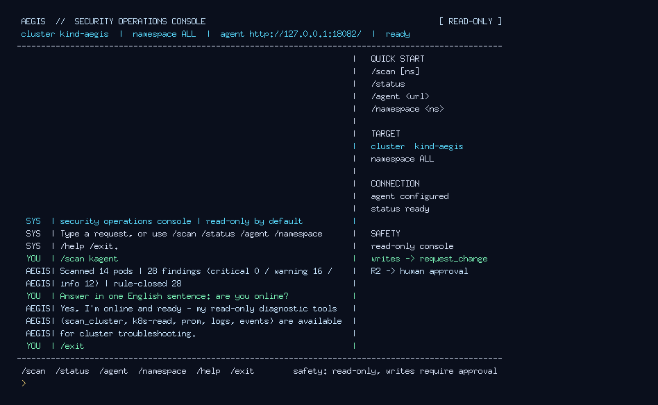

# 2026-10-21 aegis TUI 设计迭代记录

## 目标

把默认 `aegis-cli` 从“行式 REPL”升级为 Claude Code/Codex 风格的全屏 TUI：
- 标题/连接状态/只读标签；
- 会话历史主栏；
- quick start / target / safety 侧栏；
- 底部提示与输入行；
- `/scan` 仍为本地 Tier-0，不需要 LLM。

## 迭代过程（多模态）

1. 初版：全屏 header/body/footer，底部 prompt；截图发现大量空白、标点显示为方块。
2. 第二版：底部锚定近期对话；用 ASCII `|` 替代 `·`，统一英文 UI；截图仍偏空。
3. 第三版：增加右侧 `QUICK START / TARGET / CONNECTION / SAFETY` 侧栏、`[READ-ONLY]` 标签；截图布局平衡。
4. 第四版：按词换行（避免 `/he` / `lp` 断词）、扫描摘要英文化、侧栏与主栏对齐；截图见下。

## 最终截图



## 使用

```bash
GOCACHE="$PWD/.cache/gocache" go build -o bin/aegis-cli ./cmd/aegis-cli
bin/aegis-cli        # TTY 下自动进入 TUI
```

非 TTY/管道场景自动回退到行式 session；截图/调试可强制：

```bash
printf '/scan kagent\n/exit\n' | env AEGIS_TUI=force AEGIS_TUI_DUMP=/tmp/frame.txt bin/aegis-cli
```

## 边界

- 只读会话；写仍走 gatekeeper `request_change` + 审批；
- 当前为 canonical-mode 行输入，未实现 raw-mode 方向键历史/流式 token；
- TUI 为 ASCII-first（截图不依赖 CJK 字体）；真实终端中的中文模型输出仍会保留（行式 session）或经 ASCII 归一化（TUI）。
